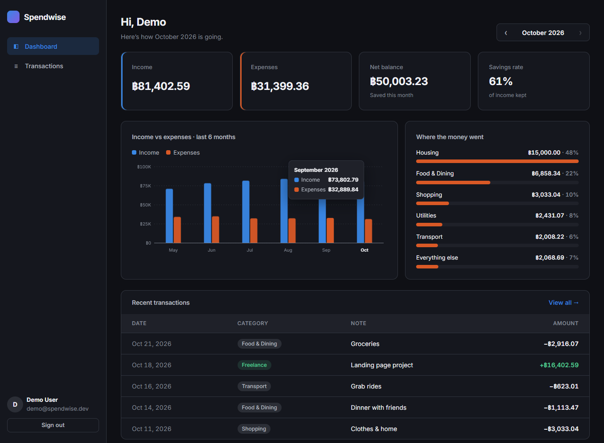
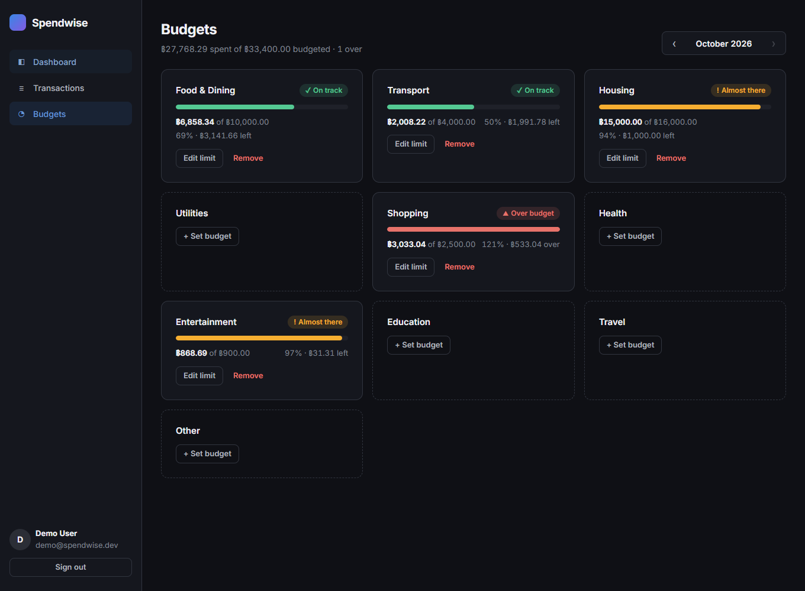
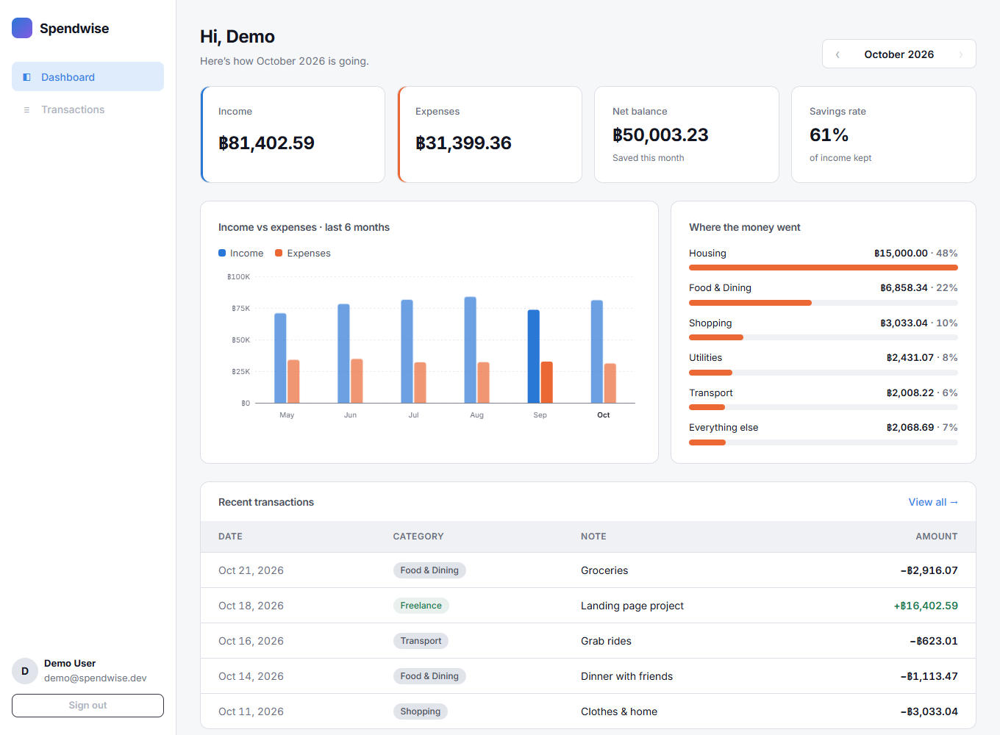
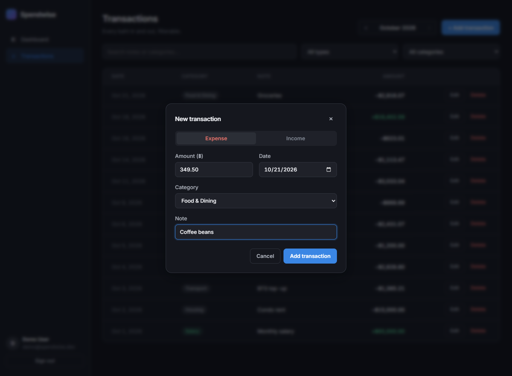

# Spendwise

A full-stack personal finance tracker. Record income and expenses, filter and search them, and see a monthly dashboard showing where your money went.



| Budgets | Light mode | Add transaction |
|---|---|---|
|  |  |  |

## Features

- **Accounts.** Register and log in with email and password. Passwords are hashed with bcrypt and sessions use JWT bearer tokens.
- **Transactions.** Create, edit and delete income and expense records. You can filter by month, type and category, and search notes with debounced input.
- **Dashboard.** Shows KPI tiles for income, expenses, net balance and savings rate, a 6-month income vs. expense chart with hover tooltips, and a ranked breakdown of spending by category.
- **Budgets.** Set a monthly limit for each expense category. Each budget shows *On track*, *Almost there* (80% or more) or *Over budget*, using an icon and a label as well as color. The dashboard warns when a category goes over its limit.
- **CSV export and import.** Export the current filtered view to a CSV file. Imports accept columns in any order and are all-or-nothing: if any row is invalid, nothing is saved and every bad row is reported. Exported cells that start with `=`, `+`, `-` or `@` are escaped so spreadsheets don't run them as formulas.
- **Per-user data.** Every query is scoped to the signed-in user, and the tests cover this.
- **Money stored as integer cents.** This avoids floating-point drift.
- **Responsive UI.** Works on desktop and phones, follows the system dark/light setting, and is keyboard accessible. Charts include a screen-reader table.

## Tech stack

| Layer | Choice | Why |
|---|---|---|
| Frontend | React 19, TypeScript, Vite, React Router | Fast dev loop and type safety from end to end |
| Charts | Hand-built SVG | No chart library; gives full control over accessibility and theming |
| Backend | Express 5, TypeScript, Zod | Async error handling, plus runtime validation that matches the static types |
| Database | SQLite through Node's built-in `node:sqlite` | Needs no native build step and no separate server |
| Auth | bcryptjs, jsonwebtoken, helmet | Standard, well-audited building blocks |
| Testing | Vitest, Supertest, Testing Library | API integration tests and component tests |
| Delivery | Docker multi-stage image, GitHub Actions CI | Typecheck, test and build run on every push |

## Architecture

```text
client/ (React SPA)              server/ (Express API)
  auth/         ──── /api/auth ────▶  auth/          register · login · JWT
  transactions/ ── /api/transactions ▶ transactions/  routes → service → repository
  dashboard/    ──── /api/summary ──▶  summary/       SQL aggregation + trend fill
  budgets/      ──── /api/budgets ──▶  budgets/       limits + spending status
                                       db/            schema + node:sqlite
```

The server is organised by feature. Each feature module has its own routes, Zod schemas, service (business rules) and repository (SQL). `createApp()` receives its dependencies as arguments, so tests run against an in-memory SQLite database.

## Getting started

You need **Node.js 22.13 or later**. Node 24 is recommended because the project uses the built-in `node:sqlite` module.

```bash
npm install
npm run seed     # creates demo@spendwise.dev / demo1234 with 6 months of sample data
npm run dev      # API on :4000, web app on http://localhost:5173
```

On the login page, click **Use demo account** to sign in as the demo user.

### Scripts

| Command | What it does |
|---|---|
| `npm run dev` | Runs the API (tsx watch) and Vite together |
| `npm test` | Runs the server and client test suites |
| `npm run typecheck` | Runs strict TypeScript checks on both workspaces |
| `npm run build` | Builds the SPA and compiles the API |
| `npm start` | Starts the compiled API. Set `CLIENT_DIST` and it also serves the SPA |

### Environment

To configure the server, copy `server/.env.example` to `server/.env`.

| Variable | Default | Notes |
|---|---|---|
| `PORT` | `4000` | |
| `DATABASE_PATH` | `spendwise.db` | `:memory:` also works |
| `JWT_SECRET` | dev-only fallback | **Required** when `NODE_ENV=production` |
| `CLIENT_DIST` | unset | Path to `client/dist`, if the API should serve the SPA |

### Docker

```bash
docker build -t spendwise .
docker run -p 4000:4000 -e JWT_SECRET=$(openssl rand -hex 32) -v spendwise-data:/data spendwise
```

## API

All endpoints except `/api/auth/register`, `/api/auth/login` and `/api/health` require `Authorization: Bearer <token>`.

| Method | Path | Description |
|---|---|---|
| `POST` | `/api/auth/register` | `{ email, password, name }` → `{ token, user }` |
| `POST` | `/api/auth/login` | `{ email, password }` → `{ token, user }` |
| `GET` | `/api/auth/me` | Returns the current user |
| `GET` | `/api/transactions` | Query params: `month=YYYY-MM`, `type`, `category`, `search`, `limit` |
| `POST` | `/api/transactions` | `{ type, amountCents, category, note?, occurredOn }` |
| `PATCH` | `/api/transactions/:id` | Partial update. The category is re-validated against the type |
| `DELETE` | `/api/transactions/:id` | Returns `204` |
| `GET` | `/api/transactions/categories` | Lists income and expense categories |
| `GET` | `/api/transactions/export` | Returns a CSV download. Accepts the same filters as the list endpoint |
| `POST` | `/api/transactions/import` | `Content-Type: text/csv`. Columns: `date,type,category,amount[,note]`. Returns `422` with per-row issues |
| `GET` | `/api/summary?month=YYYY-MM` | Totals, savings rate, category breakdown and 6-month trend |
| `GET` | `/api/budgets?month=YYYY-MM` | Budgets with the amount spent, remaining and status |
| `PUT` | `/api/budgets/:category` | `{ limitCents }`. Creates or updates the budget |
| `DELETE` | `/api/budgets/:category` | Removes the budget |

Errors use the same JSON format everywhere: `{ "error": { "code", "message", "issues?" } }`.

## Testing

- **Server (38 tests).** Covers the auth flows (duplicate email, forged and expired tokens, malformed JSON), the transaction CRUD lifecycle, filtering (including escaping of `LIKE` wildcards), isolation between users, summary aggregation and trend zero-filling, budget status thresholds, the CSV parser (quoted fields, embedded newlines, BOM, formula escaping), all-or-nothing imports and SPA fallback hosting.
- **Client (24 tests).** Covers money parsing without float drift, formatting, month arithmetic, the transaction form (type switching, validation, surfacing server errors) and the budget card's states and editing.

## Deploying a live demo (Render, free plan)

The repo includes a [`render.yaml`](render.yaml) blueprint.

1. Push the repo to GitHub.
2. In Render, choose **New → Blueprint** and select the repo. Render builds the app, generates `JWT_SECRET` and starts the service.
3. Every start re-seeds the demo account, so visitors can sign in straight away with **Use demo account**.

> The free plan has no persistent disk. The database lives in `/tmp` and is reset on every restart, which keeps the public demo clean. For real use, attach a disk and point `DATABASE_PATH` at it, or deploy the Docker image.

## Roadmap

- [x] Monthly budgets per category with over-budget alerts
- [x] CSV import and export
- [ ] Recurring transactions
- [ ] Refresh-token rotation and login rate limiting
- [ ] Playwright end-to-end tests in CI
- [ ] Migrate to PostgreSQL behind the repository interfaces for multi-instance deploys
